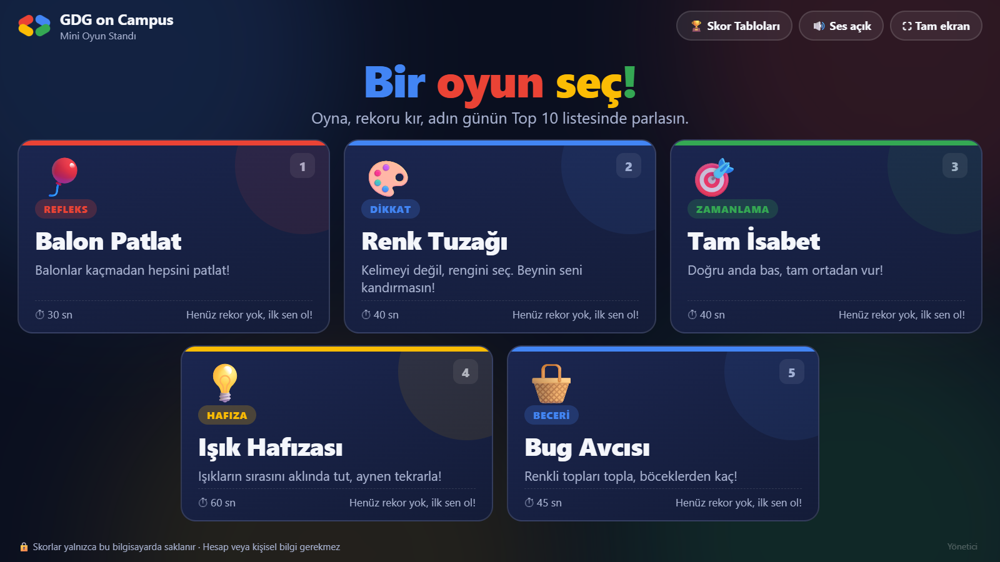
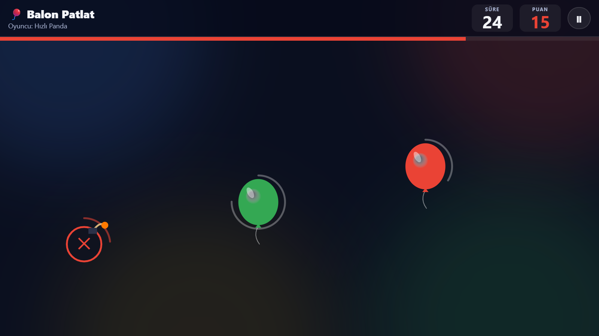
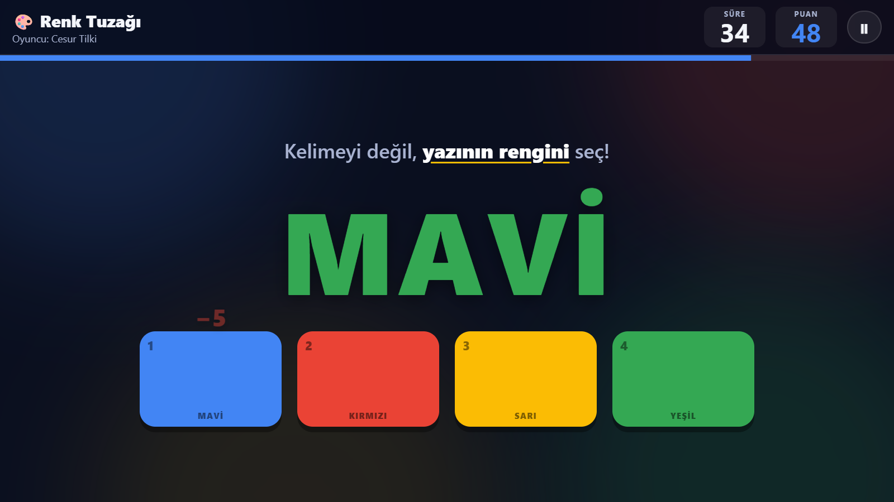
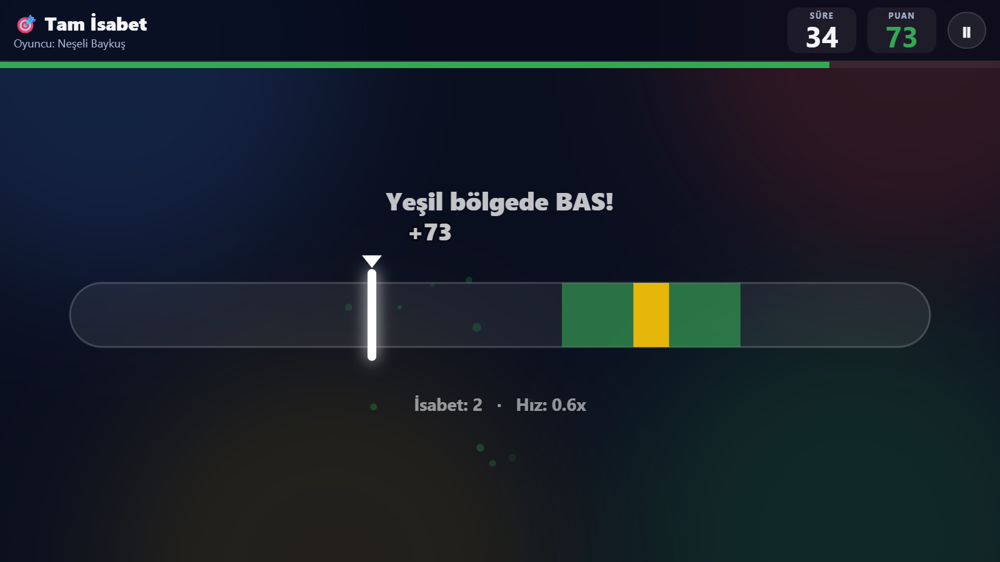
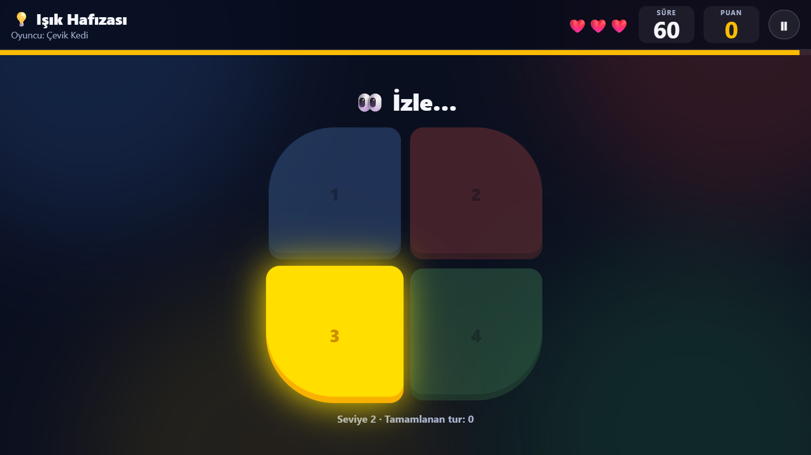
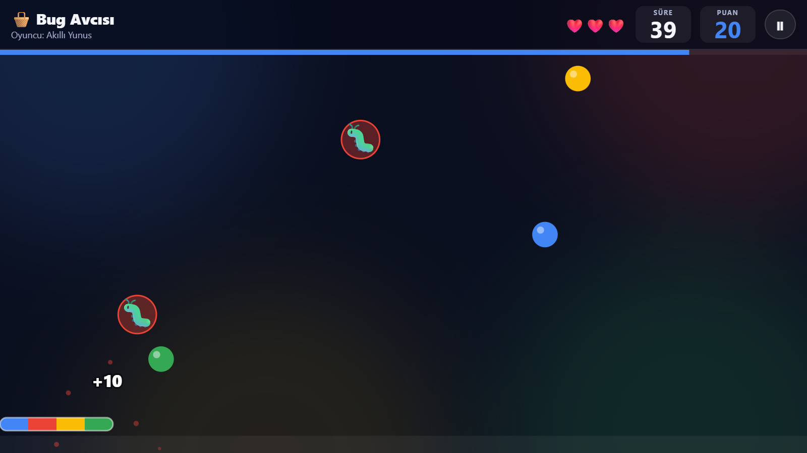
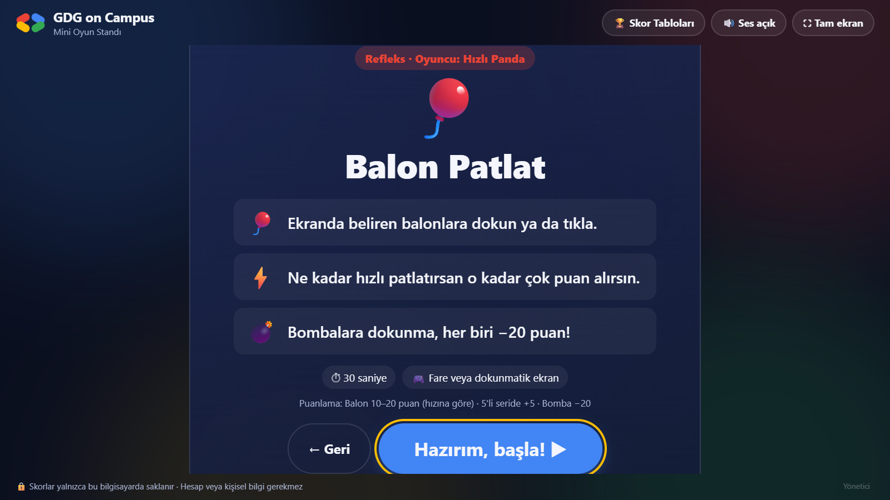

# 🎮 GDG on Campus Mini Oyun Standı

[🇬🇧 English](README.md) | 🇹🇷 **Türkçe**


GDG on Campus EBYÜ standındaki bilgisayar için hazırlanmış, **internetsiz çalışan 5 mini oyunluk** bir platform. Kurulum, sunucu ya da kütüphane gerekmez; saf HTML, CSS ve JavaScript ile yazılmıştır.

**▶️ Tarayıcıda oyna:** https://busrayanal.github.io/GDG-Mini-Oyun-Standi/

<p align="center">
  
</p>

## 🕹️ Oyunlar

| Oyun | Beceri | Süre | Kontroller |
|---|---|---|---|
| 🎈 Balon Patlat | Refleks | 30 sn | Fare / dokunma |
| 🎨 Renk Tuzağı | Dikkat | 40 sn | Dokunma / 1–4 tuşları |
| 🎯 Tam İsabet | Zamanlama | 40 sn | Boşluk / tıklama / dokunma |
| 💡 Işık Hafızası | Hafıza | 60 sn, 3 can | Dokunma / 1–4 tuşları |
| 🧺 Bug Avcısı | Beceri | 45 sn, 3 can | Fare / parmak / ← → |

Her oyunun kendi **günlük Top 10** tablosu vardır. Gün değişince tablolar kendiliğinden boşalır; eski günlerin skorları dışa aktarım için saklanmaya devam eder.

## 📸 Ekran Görüntüleri

| 🎈 Balon Patlat | 🎨 Renk Tuzağı |
|:---:|:---:|
|  |  |
| **🎯 Tam İsabet** | **💡 Işık Hafızası** |
|  |  |
| **🧺 Bug Avcısı** | **📋 Oyun açıklama ekranı** |
|  |  |

## ✨ Özellikler

- **İnternetsiz çalışır:** Sesler bile WebAudio ile kodda üretilir, hiçbir dosya indirilmez.
- **Kalıcı skorlar:** Skorlar tarayıcının yerel deposunda (localStorage) tutulur. Sayfa yenilense ya da bilgisayar yeniden başlasa da kaybolmaz.
- **Stand için tasarlandı:** Tam ekran (kiosk) modu, başında kimse yokken ana ekrana otomatik dönüş, sekme değişince otomatik duraklatma, skor tablolarında otomatik geçiş.
- **Yönetici paneli:** PIN korumalı; CSV/JSON dışa aktarma, yedekten geri yükleme ve skor silme.
- **Klavye, fare ve dokunmatik ekran** desteği.

## ▶️ Standda Çalıştırma

- **En kolay yol:** `baslat.bat` dosyasına çift tıklayın. Chrome (yoksa Edge) tam ekran kiosk modunda açılır. Çıkmak için **Alt+F4**.
- **Alternatif:** `index.html` dosyasını Chrome veya Edge ile açın, sağ üstteki **⛶ Tam ekran** butonuna basın (ya da F11).

> [!IMPORTANT]
> Skorlar tarayıcıya ve klasör yoluna bağlıdır:
> - Stand boyunca **hep aynı tarayıcıyı** ve **aynı klasör yolunu** kullanın. Klasörü taşırsanız skorlar eski yolda kalır.
> - Gizli/InPrivate pencere kullanmayın.
> - Günün sonunda yönetici panelinden yedek alın.

## ⌨️ Kısayollar

| Ekran | Tuş |
|---|---|
| Ana ekran | `1`–`5` ile oyun seç |
| Açıklama | `Enter` ile başla |
| Oyun | `Esc` / `P` ile duraklat, `Enter` ile devam |
| Her yerde | `Ctrl+Shift+A` ile yönetici paneli |

## 🔐 Yönetici Paneli

Sağ alttaki soluk **Yönetici** bağlantısından ya da `Ctrl+Shift+A` ile açılır. **Varsayılan PIN: `2468`.** İlk iş panelden değiştirin.

- Bugünün özeti (oyun başına oynanma sayısı ve rekor)
- CSV dışa aktarma (bugün veya tümü; Excel uyumlu, `;` ayraçlı) ve tam yedek (JSON)
- JSON yedeğini geri yükleme (başka bilgisayara taşırken)
- Tek tek skor silme (uygunsuz takma adlar için)
- **Günü sıfırla:** Bugünün skorlarını önce CSV olarak indirir, sonra siler
- PIN değiştirme, tüm verileri silme (önce JSON yedeği indirir)

## 📁 Proje Yapısı

```
GDG-Mini-Oyun-Standi/
├── index.html        # Tüm ekranlar (ana ekran, ad girişi, oyun, sonuç, skorlar, yönetici)
├── baslat.bat        # Stand bilgisayarında kiosk modunda başlatır
├── css/style.css
├── docs/screenshots/ # README ekran görüntüleri
└── js/
    ├── core.js       # Ortak yardımcılar, skor deposu, sesler, canvas ve efektler
    ├── app.js        # Platform akışı, skor tabloları, yönetici paneli
    └── games/        # Her oyun ayrı bir dosyada
```

## ➕ Yeni Oyun Eklemek

1. `js/games/` altına bir dosya ekleyin ve oyunu `GAMES.push({...})` ile kaydedin.
2. `index.html` içine o dosya için bir `<script>` etiketi ekleyin.

Bir oyun şu alanları tanımlar:

```js
GAMES.push({
  id, title, skill, icon, color, duration, tagline, rules, controls, scoring,
  create(stage, api) {
    // döndürür: { start?(), update(dt), draw?(), onEnd?(), destroy() }
  }
});
```

- `onEnd()` isteğe bağlıdır ve sonuç ekranında gösterilecek bonus metnini döndürür.
- `api`: `running()`, `addScore(n)`, `status(html)`, `end(reason)`, `shake()`, `sfx`

Platform akışı: **Oyun seç → takma ad → açıklama → 3 sn geri sayım → oyna → sonuç → ana ekran**

## 👩‍💻 Geliştirici

**Büşra Amine Yanal** · [GitHub](https://github.com/busrayanal)
